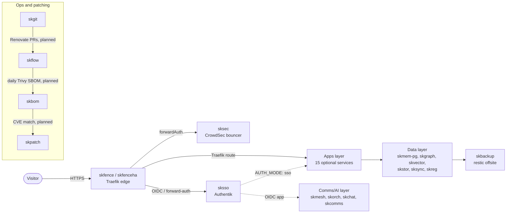

# skworld.io

The umbrella site for **SKWorld**, sovereign AI infrastructure built to be owned
rather than rented.

This repository holds the **website only**. Every project it links to lives in
its own repository.

- Custom domain (from `CNAME`): `skworld.io`
- Organisation: <https://github.com/smilinTux>

## What the page is

An index of the ecosystem, ordered the way the stack is built: **silicon to
soul**. Seven layers, 36 projects, each linking to its own site.

```
01  Identity and Security      4 projects
02  Infrastructure             6
03  Memory and Data            5
04  Communication              2
05  Agents and the OS          6
06  Soul                       4
07  Products and Research      9
```

The layer order carries meaning and should not be reshuffled alphabetically:
the floor comes first and the soul comes last, which is the argument the site
is making.

## Platform map

The home page also carries a **platform map**: every SKStacks service, grouped
into six layers (edge, identity, ops and patching, data, apps, comms/AI), with
only documented relationships drawn. It is authored as an
[Archify](https://github.com/tt-a1i/archify) JSON source,
`diagrams/skworld.platform.json`, rendered to the self-contained, interactive
`diagrams/skworld.platform.html` linked from the page. Both are regenerated
together whenever the underlying topology changes, per the
[Architecture & Data-Flow Standard](https://github.com/smilinTux/sk-standards/blob/main/standards/ARCHITECTURE_AND_DATAFLOW_STANDARD.md).

Mermaid stays the canonical, text-diffable fallback. This is the same system
context, in words a reader (or an AI agent) can read without opening the
interactive view:



See `data/status.json` for the live, hourly-refreshed numbers that go with
this map (SKStacks/SKPatch/skaegis release and CI state, the pinned-image table, and
the skpatch program's cadence lanes).

## Editing the project list

`index.html` and `sitemap.xml` are **generated**. The source of truth is the
layer table in the generator, so a new project is added in one place:

1. Add the entry to the appropriate layer.
2. Regenerate, which rewrites both `index.html` and `sitemap.xml`.
3. Commit both.

Adding a project by hand-editing `index.html` alone will leave `sitemap.xml`
stale.

## Layout

```
index.html      the page (generated)
style.css       the only stylesheet
sitemap.xml     the page plus every project subdomain (generated)
CNAME           custom domain for GitHub Pages
.nojekyll       serve files verbatim, no Jekyll processing
robots.txt      crawler policy, AI crawlers explicitly welcomed
llms.txt        machine-readable summary of the whole ecosystem
og-image.svg    social card source
og-image.png    social card, 1200x630
diagrams/       the platform map: Archify JSON source + rendered HTML
data/status.json  live SKStacks/SKPatch/skaegis snapshot, refreshed hourly by status.yml
tools/collect_status.py  the script that builds data/status.json (also run by status.yml)
```

## Hosting

GitHub Pages, classic branch-based deploy from `main` at the repository root.

DNS is Cloudflare. The apex is **proxied**, which is required for apex flattening
and for the `www` to apex redirect. This differs from the project subdomains,
which are DNS-only so that GitHub can issue their certificates and enforce
HTTPS. Do not copy the subdomain pattern to the apex.

## Local preview

```bash
python3 -m http.server 8080
# then open http://localhost:8080/
```

## CI

- `validate-site`: confirms `CNAME` and `.nojekyll` exist, checks HTML
  well-formedness, and verifies every internal link and anchor resolves.
- `secret-scan`: runs the pinned gitleaks binary over the full history.
- `status`: hourly (plus manual dispatch), regenerates `data/status.json` from
  the public GitHub API via `tools/collect_status.py` and commits it only when
  it changed. Never deploys anything.

License: Apache-2.0.
